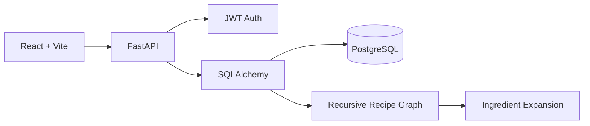

# Recipe Composition & Management System

**Inter IIT Tech Meet 15.0 — Developers Selection Task**

A full-stack recipe management application built around **recipe reuse**: recipes can contain raw ingredients and previously-created recipes, with arbitrary nesting and recursive expansion.

## Submission details

- **Name:** Yuvraj Singh Sandhu
- **Roll No.:** `26MI10111`

## Implemented requirements

### Core
- Create, edit and delete recipes.
- Add/remove raw ingredients with quantities and units.
- Add/remove existing recipes as components without redefining ingredients.
- Serving sizes and recipe metadata.
- Expand/collapse nested recipes.
- Clearly distinguish Ingredient vs Recipe components.
- Arbitrary nesting; UI is data-driven and not hard-coded to a nesting depth.
- Recursive consolidated ingredient calculation.
- Circular dependency prevention when composing recipes.
- Ownership isolation: authenticated users manage only their own recipes.

### Backend
- FastAPI REST API.
- JWT authentication with password hashing.
- SQLAlchemy data model.
- PostgreSQL in Docker; SQLite fallback for local development.
- Validation and useful HTTP error responses.
- Health endpoint: `GET /health`.

### Bonus-style features included
- Search recipes by name.
- Category, vegetarian, vegan, prep/cooking time, and difficulty fields.
- Docker Compose setup.
- Automated backend test for recursive quantity expansion.

## Architecture



## Database design

- `users`: authenticated owners.
- `recipes`: recipe metadata and serving size.
- `ingredients`: de-duplicated ingredient catalog.
- `recipe_components`: join structure. Each row references either an ingredient **or** another recipe, plus quantity and unit.

This structure supports arbitrary nesting while keeping recipe reuse normalized.

## API

- `POST /auth/register`
- `POST /auth/login`
- `GET /me`
- `GET /ingredients`
- `GET /recipes`
- `GET /recipes/:id`
- `POST /recipes`
- `PUT /recipes/:id`
- `DELETE /recipes/:id`
- `POST /recipes/:id/components`
- `PUT /recipes/:id/components/:componentId`
- `DELETE /recipes/:id/components/:componentId`
- `GET /recipes/:id/expand`

Interactive Swagger docs are available at `/docs` when the backend is running.

## Circular dependency handling

Before a recipe is attached as a child, the backend walks its existing recipe references. If it can reach the parent recipe, the new edge would form a cycle and the API rejects the operation with HTTP 400.

The recursive ingredient-expansion endpoint also maintains an active recursion path, so even malformed database state cannot silently recurse forever.

## Run with Docker

1. Copy `.env.example` to `.env` and replace the JWT secret.
2. Run:

```bash
docker compose up --build
```

3. Open `http://localhost:5173`.
4. API docs: `http://localhost:8000/docs`.

Demo account seeded on first startup:

- Email: `demo@example.com`
- Password: `demo1234`

## Local development without Docker

### Backend

```bash
cd backend
python -m venv .venv
# activate the environment
pip install -r requirements.txt
uvicorn app.main:app --reload
```

By default the backend uses `sqlite:///./recipes.db`.

### Frontend

```bash
cd frontend
npm install
npm run dev
```

The frontend defaults to `http://localhost:8000` for the API. Override with `VITE_API_URL` if needed.

## Tests

```bash
cd backend
pytest -q
```

## Assumptions

- Ingredient totals are consolidated by ingredient and unit; different units are intentionally not converted.
- Reusing a recipe applies its component quantities multiplied by the quantity of that recipe component.
- Deleting a recipe that is still referenced is blocked to preserve graph integrity.
- The provided task PDF says the exact external dataset structure will be supplied separately; this submission therefore seeds a small compatible demo dataset so the application is immediately runnable. fileciteturn0file0L59-L99

## Task alignment

The implementation follows the supplied brief's emphasis on recipe reuse, arbitrary nesting, explorer UI, full management, database design, APIs, authentication, recursive expansion, cycle handling, Dockerization, and README-based submission documentation. fileciteturn0file0L5-L9 fileciteturn0file0L101-L130 fileciteturn0file0L132-L193 fileciteturn0file0L195-L240

## Verification note

Source files were statically checked for Python syntax in the provided execution environment. Full dependency installation/test execution was not possible in this environment because outbound package downloads were unavailable; run the documented `pytest -q` and Docker build commands on a machine with Docker/npm/pip network access before final submission.
